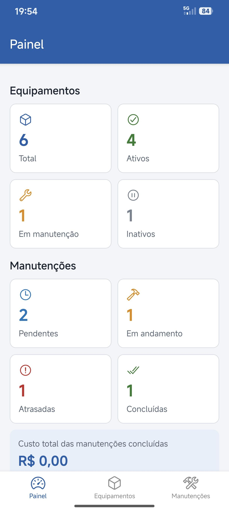
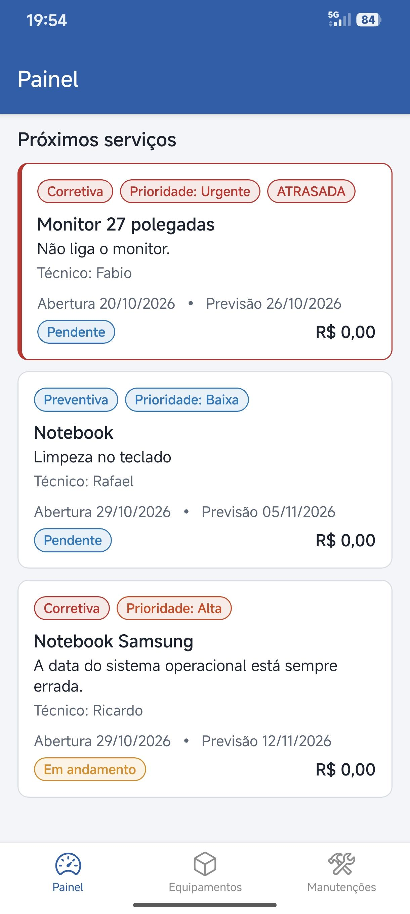
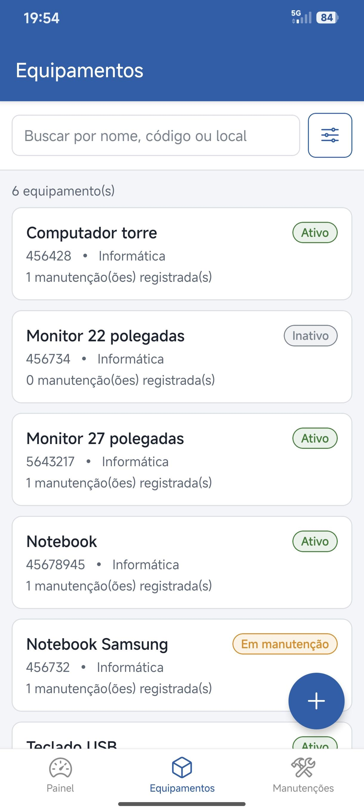
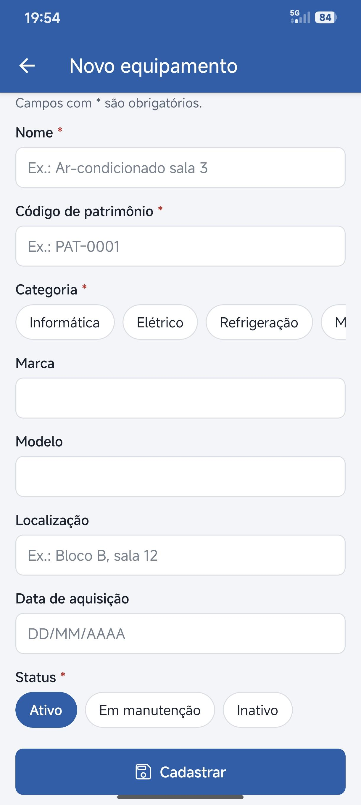
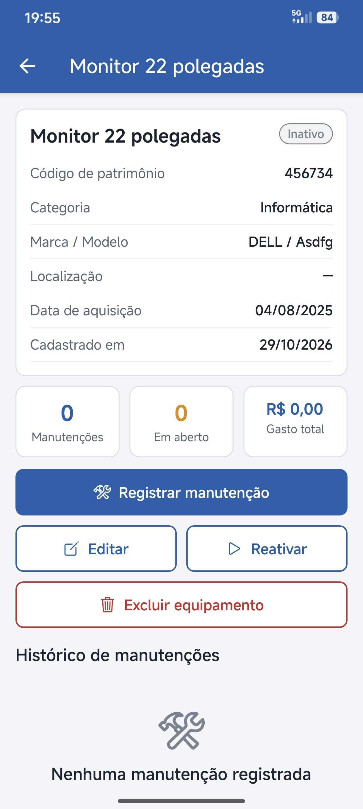
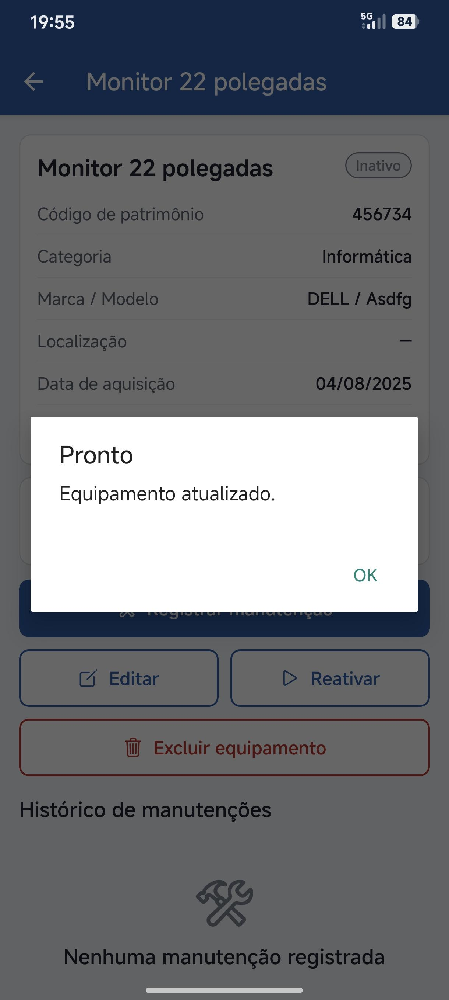
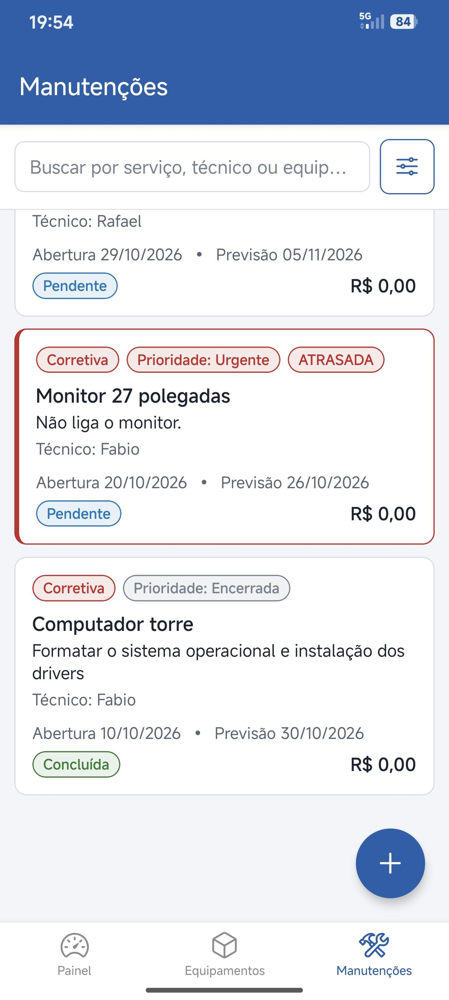

# Controle de Manutenção de Equipamentos

Aplicativo mobile (React Native + Expo + SQLite) para cadastrar equipamentos, registrar
manutenções preventivas e corretivas, e acompanhar a situação dos serviços.

## Como executar (emulador Android Studio)

1. Abra o Android Studio e inicie o emulador (Device Manager ▶).
2. Na pasta do projeto:
   ```bash
   npm install
   npx expo start
   ```
3. Com o Metro aberto, pressione **`a`**: o Expo instala o Expo Go no emulador e abre o app.

## Funcionalidades

- **Painel**: totais de equipamentos e manutenções por situação, atrasadas, custo total e próximos serviços.
- **Equipamentos**: CRUD completo, busca, filtros (status, categoria) e ordenação.
- **Manutenções**: CRUD completo, busca, filtros (situação, tipo) e ordenação.
- **Histórico**: cada equipamento mostra suas manutenções e o gasto total.
- O status do equipamento muda sozinho para "Em manutenção" quando há serviço "Em andamento".

## Organização do código

```
src/
├── app/            Telas (Expo Router: cada arquivo é uma rota)
├── components/     Componentes visuais reutilizáveis
├── database/       Database.js: conexão única (singleton) e criação das tabelas
├── errors/         ValidacaoError, BancoDadosError, RegistroNaoEncontradoError
├── models/         Classes de negócio (POO)
├── repositories/   Acesso ao SQLite (CRUD, filtros e ordenação em SQL)
└── utils/          Datas, números, constantes, cores e alertas
```

## Conceitos aplicados

| Conceito | Onde |
|---|---|
| Classes e objetos | `models/`, `repositories/` |
| Encapsulamento | Campos privados (`#nome`, `#custo`...) com getters/setters que validam |
| Herança | `Entidade` → `Equipamento` / `Manutencao` → `ManutencaoPreventiva` / `ManutencaoCorretiva`; `Repositorio` → repositórios; `BancoDadosError` → `RegistroNaoEncontradoError` |
| Polimorfismo | `getPrioridade()`, `validarRegrasDoTipo()`, `descricaoTipo`, `proximaManutencao()` e `periodicidadeDias` variam por tipo de manutenção |
| Classe abstrata | `Entidade`, `Manutencao` e `Repositorio` não podem ser instanciadas diretamente |
| Factory | `ManutencaoFactory` cria a subclasse correta a partir do tipo |
| Validação | `coletarErros()` / `validar()` em cada modelo + `CHECK`, `UNIQUE` e `FOREIGN KEY` no banco |
| try/catch | `Repositorio.executar()` converte falhas do SQLite em mensagens compreensíveis; as telas mostram `Alert` |
| SQL com filtros | `WHERE ... LIKE ?`, `ORDER BY` com lista de colunas permitidas, `GROUP`/`SUM` no painel, `JOIN`, transações |
| Persistência | Banco `manutencao_equipamentos.db` no aparelho: os dados continuam após fechar o app |

## Banco de dados

- **equipamentos**: id, nome, codigo_patrimonio (único), categoria, marca, modelo, localizacao, data_aquisicao, status, criado_em
- **manutencoes**: id, equipamento_id (FK, ON DELETE CASCADE), tipo, descricao, tecnico, data_abertura, data_prevista, data_conclusao, custo, status, periodicidade_dias, criado_em

## Capturas de tela

| Painel | Próximos serviços | Equipamentos |
|---|---|---|
|  |  |  |
| **Novo equipamento** | **Detalhe do equipamento** | **Edição salva** |
|  |  |  |
| **Manutenções** | | |
|  | | |
